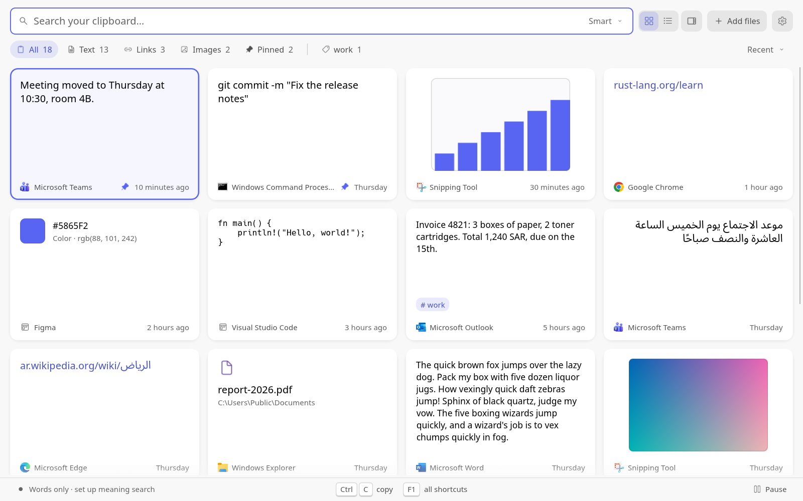
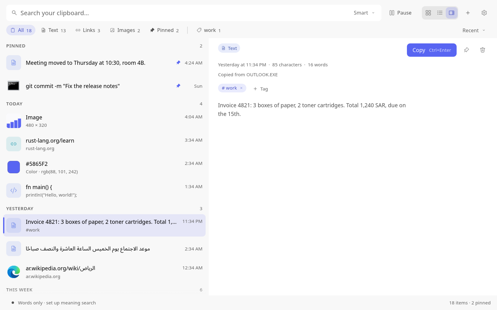
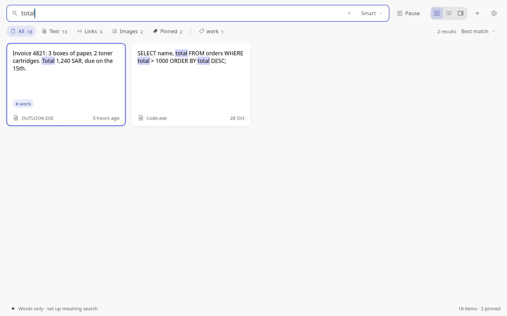
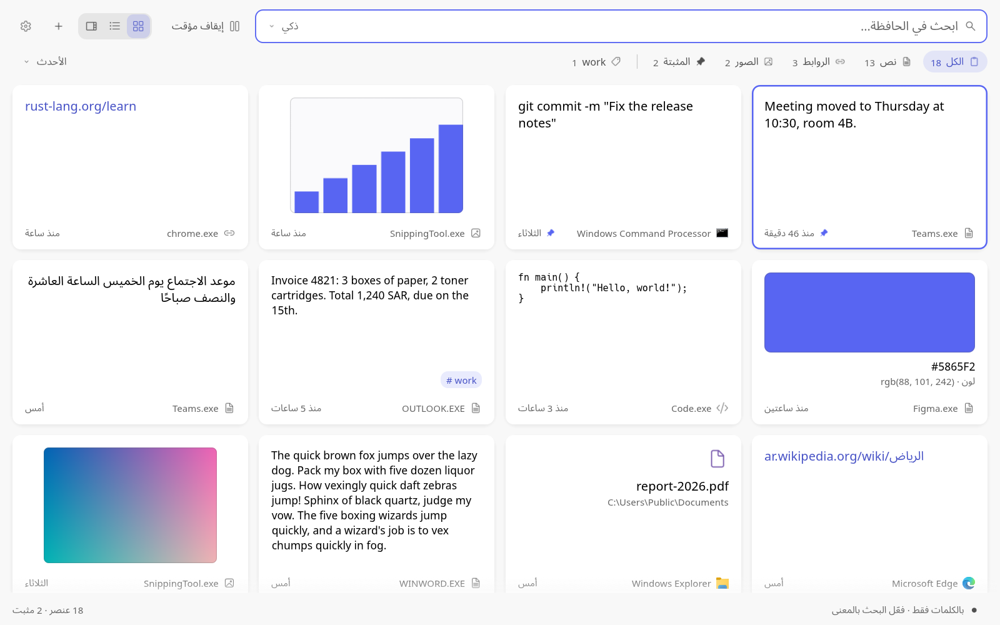
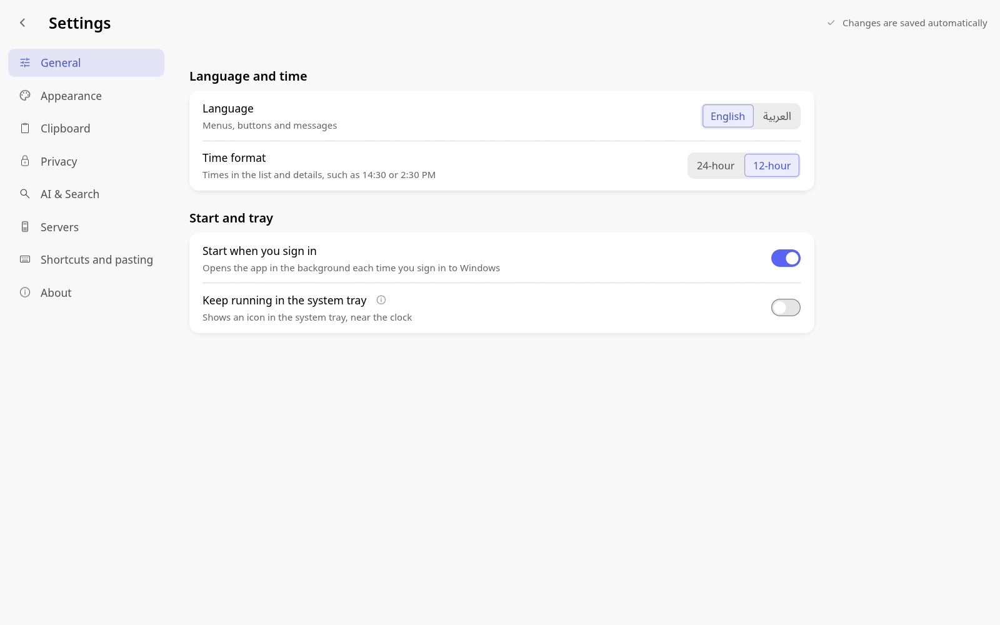

# clipboard-manager

[](https://github.com/NourEldin-Osama/clipboard-manager/actions/workflows/build-windows.yml)
[](https://github.com/NourEldin-Osama/clipboard-manager/releases/latest)
[](https://github.com/NourEldin-Osama/clipboard-manager/releases)
[](#license)

**English** · [العربية](README_AR.md)

An open-source, offline clipboard manager for Windows (also builds on Linux and macOS), written entirely in Rust.
It keeps your clipboard history, reads the text inside screenshots and images with Windows' own reader or a vision model
on your server, and lets you search everything **by meaning** with an embedding model on your own server (llama.cpp,
Ollama, LM Studio, vLLM, Unsloth or OpenRouter). For example, type *"receipt from the hardware store"* and it finds the
photo you copied last week.

[](https://github.com/NourEldin-Osama/clipboard-manager/releases/latest/download/clipboard-manager-windows-x64.exe)



| List with details | Search |
|---|---|
|  |  |
| **Arabic, right to left** | **Settings** |
|  |  |

It is a clean-room reimplementation inspired by the feature set of the Planck clipboard manager: it was written from
public feature descriptions only, and it shares no code or assets with Planck and has no affiliation with it.

## Features

| | |
|---|---|
| **Clipboard history** | Text, links, images and copied files. Duplicate copies are merged and moved to the top. Pin items to keep them forever. |
| **Tags** | Label any item with one or more tags (`Ctrl+T`, or *Add tag* in the details pane; existing tags are suggested as you type). The most used tags appear as filters beside the kind filters, tags are searchable (`work` or `#work`), and tagged items, like pinned ones, are never pruned or cleared. Right-click a tag filter to remove it from every item. |
| **Global hotkeys** | `Alt+V` opens a quick popup at the mouse pointer to search and paste, `Alt+Shift+V` opens the full window, `Alt+C` skips recording the next copy. All three can be changed in Settings. |
| **Keyboard-first** | Type to search, `↑/↓` to move, `Enter` (or double-click) pastes into the program you opened the window from with the shortcut, `Shift+Enter` pastes text without its formatting, `Ctrl+Enter` only copies, `Ctrl+1` to `Ctrl+9` paste one of the first nine items (numbered in the popup), `Ctrl+P` pins, `Ctrl+T` tags, `Shift+Del` deletes, `Ctrl+L` switches layout, `Esc` closes the details pane, clears the search or hides the window. In the grid, `↑/↓` move a row and `←/→` one card. A right-click or `Shift+F10` opens an item's menu with every action and its key, and `F1` shows every key. Every shortcut except the arrows, `Esc`, `Ctrl+1` to `Ctrl+9`, `Shift+F10` and `F1` can be changed in *Settings → Shortcuts and pasting*: click it and press the new keys. |
| **Several items at once** | `Ctrl`+click adds or removes an item, `Shift`+click selects a range, `Shift+↑/↓` extend it and `Ctrl+A` selects everything shown. The status bar then pins, tags, copies together or deletes them all, and the keys and the right-click menu act on all of them. One Undo brings back a whole deleted group. *Copy together* puts the texts, links and file paths one after another, in list order. |
| **English and Arabic** | Switch the language in *Settings → General*. Arabic lays the whole window out right to left, and Arabic text, whether part of the interface or something you copied, is shaped, ordered and wrapped correctly, even when it mixes in numbers or English. To add a language, see [docs/TRANSLATING.md](docs/TRANSLATING.md). The bundled fonts, [Noto Sans](https://github.com/notofonts/latin-greek-cyrillic) and [Noto Sans Arabic](https://github.com/notofonts/arabic) in two weights (SIL Open Font License), mean it doesn't depend on the PC's fonts. |
| **12- or 24-hour clock** | Times are stored in UTC and shown in your time zone, including daylight saving, with the clock you choose in *Settings → General*. |
| **System tray and start at sign-in** | In *Settings → General*: keep the app running in the system tray (closing or minimising the window hides it there; click the icon to open it, right-click to pause recording or quit), and start it hidden when you sign in. |
| **Text in images** | Text in images and screenshots becomes searchable. *Settings → Search & AI → Read text in images* chooses the engine: Windows' own (the default; it reads the languages installed in Windows), or a vision model on one of your servers (llama.cpp, vLLM, SGLang, Ollama…): DeepSeek-OCR-2, Unlimited-OCR-2, MiniCPM-OCR and GLM-OCR come with their own settings, and any other model works with your own prompt ([how to set one up](#reading-text-in-images-with-a-model-server)). |
| **Sort by** | The menu at the end of the filter row: *Best match* (while searching), *Recent*, *Oldest*, *A to Z* and *Most used* (items you copy back from the list most often). Searching and browsing each remember their own choice. *Settings → Appearance → Pinned on top* keeps pinned items first while browsing (not while searching). |
| **Semantic search** | Smart mode ranks by meaning (similarity), with a boost for items that contain your words; results are ordered best first and the relevance bars match that order. You can also choose *Meaning* or *Keyword* only. |
| **Your own model servers** | Save the servers your models run on, each with its type (llama.cpp, Ollama, LM Studio, vLLM, Unsloth, OpenRouter or another one, with its logo), address on any port and API key, and the models you use on it, each with its own name and settings. Pick the model in use from one menu: each model keeps its own index, so switching back needs no new indexing. **Test** checks a model, and **Fill in details** looks it up on [models.dev](https://models.dev) and fills in the prompts well-known models need. The app can also start `llama-server` for you, for search and for reading text, from a model file or a Hugging Face name. Multi-vector (ColBERT-style) output is detected and scored with MaxSim, and Matryoshka vectors can be shortened. |
| **Library import** | Drag files or folders onto the window, or use `＋ → Import folder…`. Images and text and code files are indexed alongside your clipboard. |
| **Privacy** | Nothing leaves your machine, and on Windows your history is encrypted on disk with a key tied to your Windows account. Clipboard content that password managers mark as sensitive (`ExcludeClipboardContentFromMonitorProcessing`) is never recorded. Neither is anything that looks like an API key, token, private key or random password (on by default; you can turn it off in *Settings → Privacy*, or click **Save anyway** on the message when it guessed wrong). You can pause recording at any time. |
| **Smart ranking** | Image and text similarities are each scaled by their best match before being merged, because text-to-image similarity scores are naturally much lower than text-to-text ones. Without this, photos would be buried under text. |
| **Look and feel** | A list grouped by Pinned / Today / Yesterday / This week, with kind icons, thumbnails, matched words highlighted and relevance bars while searching. Three layouts, switched with the view button beside the search box: **Grid** (cards), **List** (full-width rows) and **Detail** (list plus a details pane with a large preview). Hovering an item shows delete, pin, copy and open-details buttons (the card's content stays put). Light and dark themes, five accent colours, comfortable or compact density. |
| **Settings that explain themselves** | Seven pages down the side: General, Appearance, Clipboard, Privacy, Search & AI, Shortcuts and pasting, and About. A short line under each setting says what it does, and its ℹ button explains the rest. *Privacy* shows where each kind of data goes. Settings you've changed are highlighted, each with a one-click reset. Changes apply instantly; a server's settings wait for **Save**. |
| **Getting started, and what's new** | A new install shows a short checklist that ticks itself as you copy, paste, pin and, if you like, turn on search by meaning. After an update, the first window says so, and *What's new* shows the notes, built into the app. |

The only network access is the servers you add, models.dev when you click **Fill in details**, and the update check
described below (it can be turned off). Nothing you copy is sent, unless you choose a search or text reader server
outside this PC: the app warns about that and asks first. Everything else works without a network connection.

## Install on Windows

### Option A: download the installer or the prebuilt `.exe`
Every change merged into `main` is built on GitHub's Windows machines and published on the
[Releases page](https://github.com/NourEldin-Osama/clipboard-manager/releases/latest), with notes listing the pull requests it includes.

**clipboard-manager-windows-x64-setup.exe** installs the app for your Windows account, without administrator rights,
in `%LOCALAPPDATA%\Programs\Clipboard Manager`, with Start menu and desktop shortcuts and an entry in *Installed apps*.
Uninstalling asks whether to delete your history and settings too.

Or download **clipboard-manager-windows-x64.exe** to run it without installing, or install it with [Scoop](https://scoop.sh):

```powershell
scoop install https://github.com/NourEldin-Osama/clipboard-manager/releases/latest/download/clipboard-manager.json
```

It is a single, self-contained binary that needs no installer and no runtime. Put it anywhere you can write to, for
example `%LOCALAPPDATA%\Programs\clipboard-manager\`, and run it. To start it when you sign in, turn on
*Settings → General → Start when you sign in*.

### Updates
The app keeps itself up to date from the Releases page. On start and once a day it reads the latest release's
`updater.json` (only that file is fetched; nothing about you is sent). When there's a newer build it downloads it in the
background, then shows **Restart to update**; if you don't restart, it installs when you quit. Every download must match
the SHA-256 checksum and an Ed25519 signature made by the release workflow with a key kept as a GitHub secret; anything
else is refused. *Settings → About → Updates* turns the check off, makes it ask before downloading, and has
**Check now**. Builds made on your own PC have no build number and don't update themselves.

### Option B: build from source on Windows
1. Install Rust from <https://rustup.rs> (accept the default *MSVC* toolchain; it will offer to install the Visual Studio Build Tools).
2. In PowerShell:
   ```powershell
   git clone <this repo> clipboard-manager
   cd clipboard-manager
   cargo build --profile dist
   .\target\dist\clipboard-manager.exe
   ```

### Option C: cross-compile from Linux
```bash
rustup target add x86_64-pc-windows-gnu
sudo apt install mingw-w64
cargo build --profile dist --target x86_64-pc-windows-gnu
# -> target/x86_64-pc-windows-gnu/dist/clipboard-manager.exe
```

**Build profiles.** `cargo build --release` is tuned for quick rebuilds while you develop (no LTO, 16 codegen units).
`--profile dist` adds thin LTO for the shipped binary. Debug builds fully optimise only image decoding and lightly
optimise the rest. The first build compiles every dependency and takes a while;
after that, only this crate is rebuilt. The build is much faster on a machine with more cores than a 2-core cloud VM.
If the repo lives on a synced or network drive (Google Drive, OneDrive), keep the build cache elsewhere so builds stay fast:
`CARGO_TARGET_DIR=/some/local/dir cargo build …`

## Choosing a search model

Searching by meaning uses an embedding model on a server: one on this PC (llama.cpp, Ollama, LM Studio, vLLM, Unsloth or
the bundled Sentence Transformers server) or elsewhere (OpenRouter, or a server on your network).

### Add a server and its models
1. **⚙ Settings → Search & AI → Servers → Add server**.
2. Pick its type. The usual address fills in: llama.cpp `:8080`, Ollama `:11434`, LM Studio `:1234`, vLLM `:8000`,
   Unsloth `:8888`, OpenRouter `https://openrouter.ai/api/v1`. Change the port if your server uses another one.
3. If the server needs a key (for example `llama-server --api-key …`, Unsloth, OpenRouter, or LM Studio with auth
   enabled), paste it into **API key**. It is sent as `Authorization: Bearer <key>` and stored in `config.json` in your
   app-data folder, encrypted for your Windows account (DPAPI).
4. The app asks the server for its models (`GET /v1/models`; OpenRouter lists its embedding models at
   `/embeddings/models`) and shows *Connected · N models found*. **Test connection** asks again.
5. **Add a search model**: pick it from the list, or type a name the server doesn't list. Leave it empty for the
   server's default model. A short **Name in menus** shows in the menus and the status bar.
   - **Fill in details** looks the model up on [models.dev](https://models.dev) and fills in its name, and fills in
     the prompts well-known models are trained with (EmbeddingGemma, nomic-embed, multilingual-e5, BGE, mxbai). Nothing
     from your history is sent.
   - **Test** sends one short text and shows the vector size (how many numbers each vector has) and how long it took.
   - **Vector size** keeps fewer numbers of each vector, for Matryoshka models only. Vectors are normalised again after
     they are shortened.
6. **Save**, then pick the model under **Search by meaning → Model**. Your history is indexed in the background.

A server keeps as many models as you like, for searching and for reading text, and each model keeps its own index: going
back to a model needs no new indexing. Items missing from the model's index are embedded in the background, and the
status bar shows progress.

#### llama.cpp (`llama-server`): GGUF models such as [EmbeddingGemma 2](https://huggingface.co/unsloth/embeddinggemma-2-GGUF)
1. Download a Windows build (`llama-…-bin-win-cpu-x64.zip`, or the CUDA/Vulkan build if you have a GPU) from
   <https://github.com/ggml-org/llama.cpp/releases> and unzip it. You need a build recent enough to support EmbeddingGemma 2.
2. Download a quant from the model page, for example `embeddinggemma-2-Q8_0.gguf` (310 MB) or `UD-Q4_K_XL` (176 MB).
   Use Q8_0 or BF16 rather than F16, because the model card warns that F16 activations overflow.
3. Start it:
   ```powershell
   .\llama-server.exe -m embeddinggemma-2-Q8_0.gguf --embeddings --pooling mean --port 8080
   ```
4. In the app add a **llama.cpp** server, add a search model, and click **Fill in details**: it fills in the model's
   retrieval prompts (`task: search result | query: …` / `title: none | text: …`).
5. To find images by what they show, also download the model's `mmproj-F16.gguf`, add
   `--mmproj mmproj-F16.gguf -ub 4096 -b 4096` to the command, and turn on **Send images** for the model. **Test** says
   whether images work. With its default batch size, llama-server reads each image at a quarter of its detail.

If you'd rather not keep a console open, turn on **Start llama-server for me** in the llama.cpp server's settings,
browse to `llama-server.exe`, and choose the `.gguf` file or type the model's Hugging Face name (llama-server downloads
it the first time). The app then starts the server without opening a window when one of its models is in use, and stops
it when the app exits. It does the same for reading models; a search model and a reading model each need a server of
their own, on its own port.

#### Sentence Transformers: any model on the Hugging Face Hub
Sentence Transformers has no HTTP server of its own, so one is included: [`tools/st_server.py`](tools/st_server.py)
(standard library only, besides `sentence-transformers` itself).
```powershell
pip install -U sentence-transformers pillow
python tools\st_server.py --model google/embeddinggemma-300m --model sentence-transformers/clip-ViT-B-32
```
Add a server of type **Other** at `http://127.0.0.1:8001/v1`. Every `--model` you passed appears in its model list.
- It applies the model's own query/document prompts automatically (the app sends an `X-Embedding-Role` header), so leave the prompt fields empty.
- Image models (CLIP, SigLIP, BiUltraVBERT …) also embed your images: turn on **Send images**.
- Models that need custom code take `--trust-remote-code`, for example
  `python tools\st_server.py --model <BiUltraVBERT repo> --trust-remote-code`.
- `--device cuda` uses an NVIDIA GPU, and `--preload` loads the models at start-up instead of on first use.
- `--api-key <key>` makes the server require that key.

Ollama, LM Studio, vLLM and Unsloth have types of their own and work the same way.

#### OpenRouter
Add an **OpenRouter** server, paste your OpenRouter API key, and pick one of its embedding models, for example
`openai/text-embedding-3-small`. OpenRouter is not on this PC, so the app asks before it sends your history there.
Every request asks OpenRouter for providers that don't collect user data, so a model offered only by providers that
keep data refuses, and says so. Each embedding request also says whether it is a search or an item (`input_type`).

### BiUltraVBERT / ColUltraVBERT via vLLM (text ↔ document-image retrieval)
These MIT-licensed models are served by vLLM (Linux or WSL2 with a GPU recommended):
```bash
vllm serve <hf-repo-of-BiUltraVBERT> --task embed --trust-remote-code --served-model-name BiUltraVBERT
```
Add a **vLLM** server where vLLM listens, add the model under its served name, and turn on **Send images**.
ColUltraVBERT returns one vector per token: set **Vector size** to 128, as the authors recommend. The app ranks its
vectors with late-interaction MaxSim.

## Reading text in images with a model server

*Settings → Search & AI → Read text in images → Your own server* sends each image you copy to a reading model on one of
your servers with an OpenAI-style `/chat/completions`, such as llama.cpp, vLLM, SGLang or Ollama. Add the model to its
server with **Add a reading model**, pick its **Model type**, and choose it under **Read text in images → Model**.
**Test** sends a small test image and shows what the model read.

- **DeepSeek-OCR-2**, **Unlimited-OCR-2**, **MiniCPM-OCR** and **GLM-OCR** fill in the prompt from the model's guide,
  and each request carries the settings the guide asks for. **Fill in details** picks the type from the model's name.
  Their answer is saved as plain text: layout tags and boxes are removed, table cells are separated by spaces and rows
  by lines, and formulas stay as written.
- **Another model** sends your prompt as written and keeps the answer as it comes.

Each answer stops at 4096 tokens (about 3000 words), so a model that keeps repeating itself can't run for minutes.
The commands below come from each model's guide; they were not tested with the app. vLLM and SGLang run on Linux or
WSL2 with an NVIDIA GPU.

**DeepSeek-OCR-2** with vLLM 0.16 or newer. `--logits_processors …` turns on vLLM's guard against repeated text:
```bash
vllm serve deepseek-ai/DeepSeek-OCR-2 --logits_processors vllm.model_executor.models.deepseek_ocr:NGramPerReqLogitsProcessor --no-enable-prefix-caching --mm-processor-cache-gb 0
```
The address is `http://127.0.0.1:8000/v1`. Recent llama.cpp builds run it too, from a GGUF file and its mmproj file
(`llama-server -m <model>.gguf --mmproj <mmproj>.gguf`), but without that guard. DeepSeek publishes no GGUF files, so
these come from other people.

**Unlimited-OCR-2**: Baidu's guide on the [model page](https://huggingface.co/baidu/Unlimited-OCR-2) serves it with
SGLang, using an SGLang build of its own, under the name `Unlimited-OCR-2` on port 10000. The address is then
`http://127.0.0.1:10000/v1`. llama.cpp and vLLM don't document this version yet.

**MiniCPM-OCR** with llama.cpp build b11901 or newer. Download `MiniCPM-OCR-1_0-Q8_0.gguf` and
`mmproj-model-f16-4x.gguf` from [openbmb/MiniCPM-OCR-1.0-gguf](https://huggingface.co/openbmb/MiniCPM-OCR-1.0-gguf),
then start it:
```powershell
.\llama-server.exe -m MiniCPM-OCR-1_0-Q8_0.gguf --mmproj mmproj-model-f16-4x.gguf --ctx-size 8192 --jinja --reasoning off --alias minicpm-ocr --port 8080
```
The address is `http://127.0.0.1:8080/v1`. With a vLLM version that supports it, the address is `http://127.0.0.1:8000/v1`:
```bash
vllm serve openbmb/MiniCPM-OCR-1.0 --served-model-name minicpm-ocr --max-model-len 40960 --mm-processor-kwargs '{"downsample_mode":"4x"}' --default-chat-template-kwargs '{"enable_thinking":false}'
```

**GLM-OCR** with llama.cpp, from ggml-org's own GGUF; it is small enough for a 4 GB graphics card
([llama.cpp's guide to OCR models](https://huggingface.co/blog/ggml-org/using-ocr-models-with-llama-cpp)):
```powershell
.\llama-server.exe -hf ggml-org/GLM-OCR-GGUF --port 8080
```
The address is `http://127.0.0.1:8080/v1`. The app can also start it: add a **llama.cpp** server, turn on **Start
llama-server for me**, and type `ggml-org/GLM-OCR-GGUF` as the Hugging Face name; give it a port of its own if a search
model's server already uses 8080. Other OCR models that llama.cpp runs the same way (LightOnOCR, PaddleOCR-VL,
Dots.OCR, HunyuanOCR…) work as **Another model**, with the prompt their model card gives, often `OCR`.

## Performance

- **The UI never waits on heavy work.** OCR, embedding, thumbnail and preview decoding each run on background threads. Search
  queries jump ahead of indexing work, so results update while thousands of items are still being indexed.
- **Batched indexing.** Up to 16 items go to the model per call, which is much faster with llama.cpp and the Sentence
  Transformers server than one request per item. If a batch fails, its items are retried one by one, so a single bad item can't block the rest.
- **Cheap per keystroke.** Each item's lower-cased search text is cached. Item text is shared rather than copied, so even
  1 MB clips cost nothing to display. The list is virtualised, so only visible rows are drawn.
- **No re-ranking storm.** While indexing, results are re-ranked at most every 0.4 s, not after every new vector.
- For the fastest semantic search, run llama.cpp or the Sentence Transformers server on a GPU (`--device cuda`), or use a
  Q4/Q8 GGUF quant on the CPU.

## Where data is stored

`%APPDATA%\clipboard-manager\data\` (open it from Settings → About):

- `history.redb` stores items, OCR text and embeddings ([redb](https://github.com/cberner/redb), a pure-Rust embedded database)
- `images\` holds copied images as PNG files (`.png.enc` when encrypted)
- `config.json` holds settings, with your servers and their models, and `app.ron` the window's size and place
- `clipboard-manager.log` is a log of the current run (the previous run's is kept as `clipboard-manager.old.log`). Open it from Settings → About → *Show log* and attach it to bug reports.

On Windows the items and copied images are encrypted (AES-256-GCM) with a key that Windows itself protects for your account (DPAPI): only your account, on this PC, can open the history. The search vectors are not encrypted. A history that can't be opened, for example one from an older version or one copied from another PC or account, is moved aside as `history-unreadable-<date>.redb` and an empty one starts; one from another account still opens on the account that made it.

Set `CLIPBOARD_MANAGER_HOME` to use another folder, for example a portable install on a USB stick. Its history is encrypted too, so it opens only on the PC and account that made it.

## Architecture

```
src/
  main.rs        window setup
  app.rs         egui UI: search bar, filters, grid/list views, details pane, tags, settings
  clipboard.rs   watcher thread (arboard; clipboard sequence number + sensitive-format check on Windows)
  paste.rs       pasting into the program the user was in (brings it to the front, presses Ctrl+V)
  screen.rs      the mouse pointer and its screen, for placing the quick popup
  worker.rs      background indexer thread; owns the OCR engine + embedder; queries pre-empt indexing
  llama.rs       starts and stops llama-server for the search model and the reading model
  embed/
    mod.rs       Embedding (dense / multi-vector), cosine & MaxSim, Embedder trait
    server.rs    OpenAI-compatible client
  ocr/
    mod.rs       the chosen text reader
    windows_reader.rs  Windows' own text reader (Windows.Media.Ocr)
    server.rs    a vision model on a server, through /chat/completions
  search.rs      keyword scoring, similarity ranking with a word-match boost
  store.rs       redb persistence; items and copied images encrypted on Windows
  vault.rs       the history's key (sealed with DPAPI) and its AES-256-GCM encryption
  library.rs     the history in memory and every change to it, kept in step with the store
  import.rs      files/folders -> items
  catalog.rs     model details from models.dev, and the prompts well-known models need
  tray.rs        system-tray icon and menu (tray-icon)
  i18n.rs        interface texts from locales/*/main.ftl (Project Fluent), local date/time display
  update.rs      self-update: release manifest, signed download, exe swap
  autostart.rs   start at sign-in (auto-launch: Run key / launch agent / XDG autostart)
  installed.rs   keeps the version shown in Installed apps current as the installed app updates itself
```

The GUI, database and clipboard handling are all Rust. Searching by meaning, and reading text with a vision model, run
on the model servers you choose; Windows reads text on its own.

## Roadmap
- PDF text extraction for imported folders

## License
Dual-licensed under [MIT](LICENSE-MIT) or [Apache-2.0](LICENSE-APACHE), at your option.
