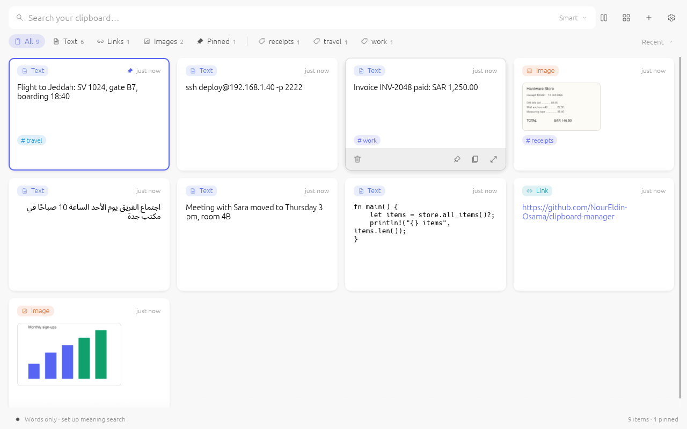
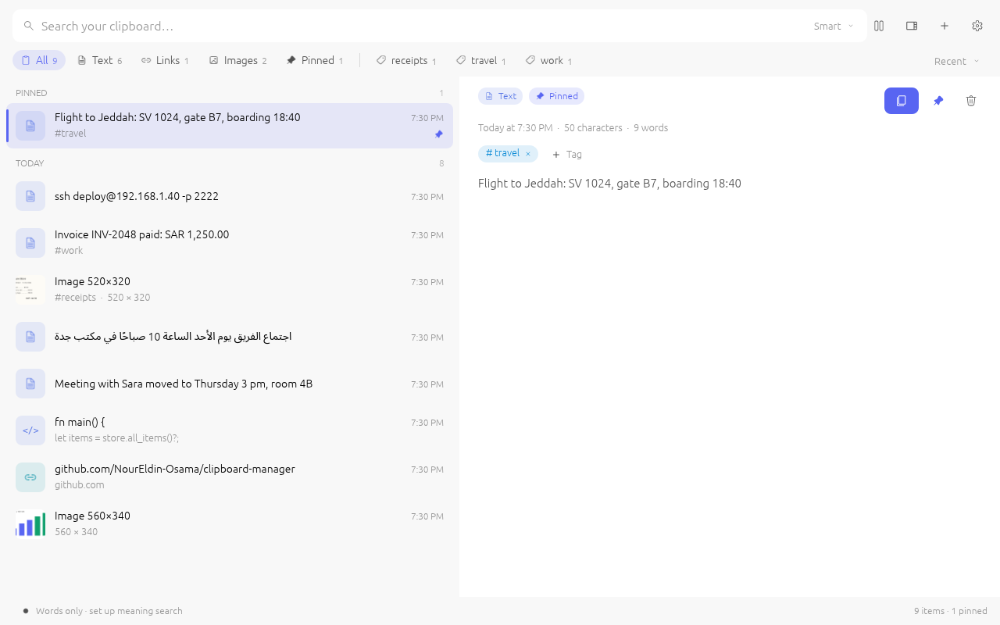
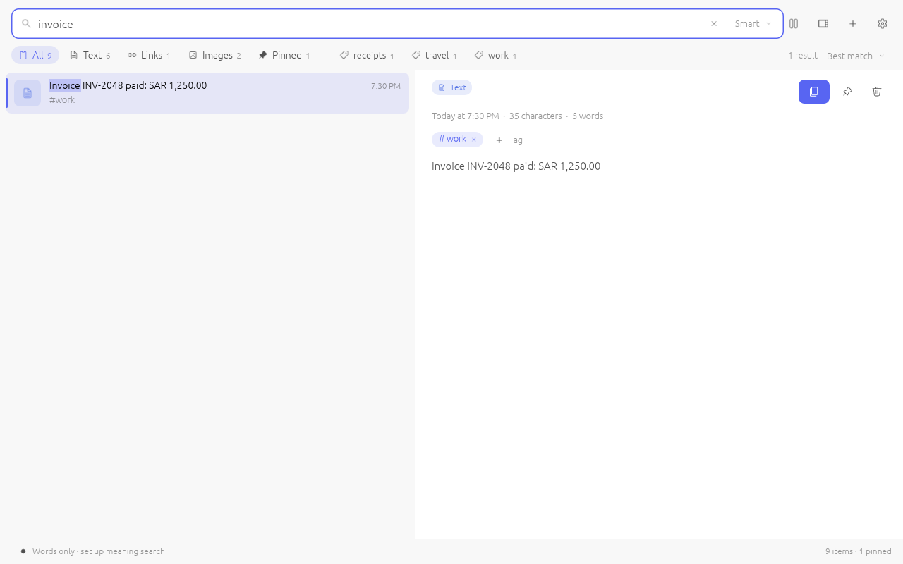
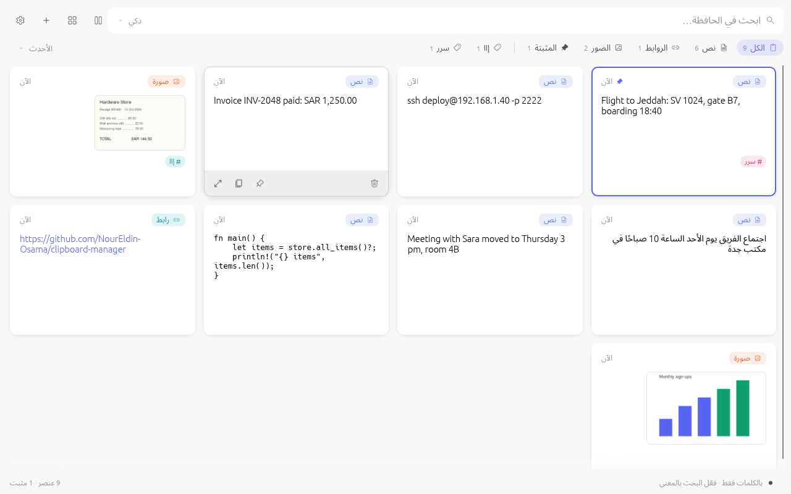
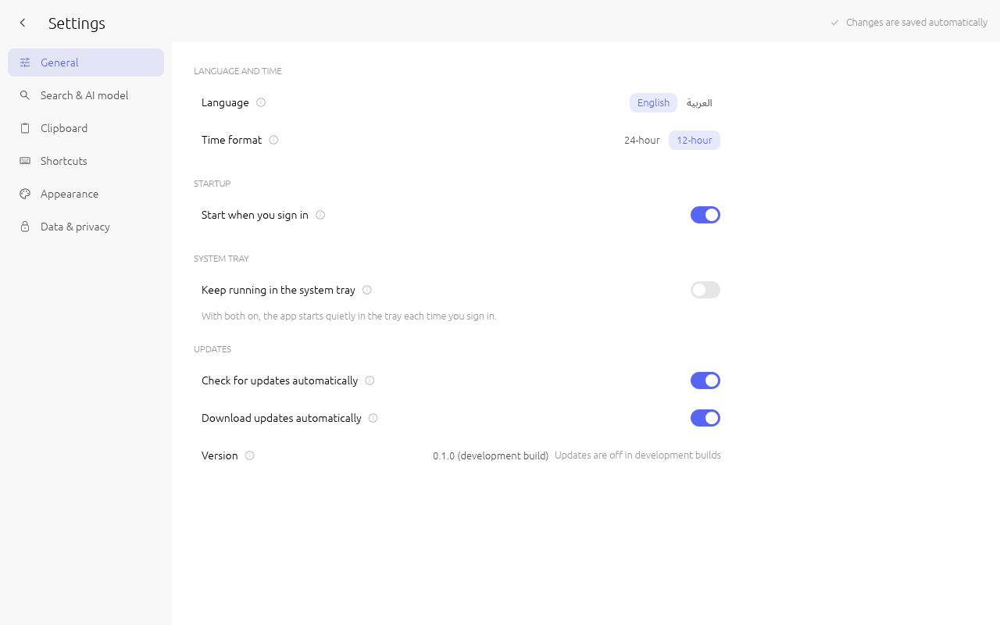

# clipboard-manager

[](https://github.com/NourEldin-Osama/clipboard-manager/actions/workflows/build-windows.yml)
[](https://github.com/NourEldin-Osama/clipboard-manager/releases/latest)
[](https://github.com/NourEldin-Osama/clipboard-manager/releases)
[](#license)

**English** · [العربية](README_AR.md)

An open-source, offline clipboard manager for Windows (also builds on Linux and macOS), written entirely in Rust.
It keeps your clipboard history, reads the text inside screenshots and images on your own machine, and lets you
search everything **by meaning** with local embedding models. For example, type *"receipt from the hardware store"* and
it finds the photo you copied last week.

[](https://github.com/NourEldin-Osama/clipboard-manager/releases/latest/download/clipboard-manager-windows-x64.exe)



| List with details | Search |
|---|---|
|  |  |
| **Arabic, right to left** | **Settings** |
|  |  |

It is a clean-room reimplementation inspired by the feature set of the Planck clipboard manager: it was written from
public feature descriptions only, and it shares no code or assets with Planck and has no affiliation with it.

## Features

| | |
|---|---|
| **Clipboard history** | Text, links, images and copied files. Duplicate copies are merged and moved to the top. Pin items to keep them forever. |
| **Tags** | Label any item with one or more tags (`Ctrl+T`, or *Add tag* in the details pane; existing tags are suggested as you type). The most used tags appear as filters beside the kind filters, tags are searchable (`work` or `#work`), and tagged items, like pinned ones, are never pruned or cleared. Right-click a tag filter to remove it from every item. |
| **Global hotkeys** | `Alt+V` opens a quick popup at the mouse pointer to search and paste, `Alt+Shift+V` opens the full window, `Alt+C` skips recording the next copy. All three can be changed in Settings. |
| **Keyboard-first** | Type to search, `↑/↓` to move, `Enter` (or double-click) pastes into the program you opened the window from with the shortcut, `Shift+Enter` pastes text without its formatting, `Ctrl+Enter` only copies, `Ctrl+P` pins, `Ctrl+T` tags, `Shift+Del` deletes, `Ctrl+L` switches layout, `Esc` closes the details pane, clears the search or hides the window. In the grid, `↑/↓` move a row and `←/→` one card. Every shortcut except the arrows and `Esc` can be changed in *Settings → Shortcuts*: click it and press the new keys. |
| **English and Arabic** | Switch the language in *Settings → General*. Arabic lays the whole window out right to left, and Arabic text, whether part of the interface or something you copied, is shaped, ordered and wrapped correctly, even when it mixes in numbers or English. To add a language, see [docs/TRANSLATING.md](docs/TRANSLATING.md). A bundled Arabic font ([Noto Sans Arabic](https://github.com/notofonts/arabic), SIL Open Font License) means it doesn't depend on the PC's fonts. |
| **12- or 24-hour clock** | Times are stored in UTC and shown in your time zone, including daylight saving, with the clock you choose in *Settings → General*. |
| **System tray and start at sign-in** | In *Settings → General*: keep the app running in the system tray (closing or minimising the window hides it there; click the icon to open it, right-click to pause recording or quit), and start it hidden when you sign in. |
| **Text in images** | Text in images and screenshots becomes searchable. *Settings → Clipboard* chooses the reader: Windows' own (the default for new installs; it reads the languages installed in Windows), the built-in one ([ocrs](https://github.com/robertknight/ocrs), pure Rust, Latin letters), or a vision model on a server you choose (llama.cpp, vLLM with DeepSeek-OCR or PaddleOCR-VL, Ollama) with your own prompt. |
| **Sort by** | The menu at the end of the filter row: *Best match* (while searching), *Recent*, *Oldest*, *A to Z* and *Most used* (items you copy back from the list most often). Searching and browsing each remember their own choice. *Settings → Appearance → Pinned on top* keeps pinned items first while browsing (not while searching). |
| **Semantic search** | Smart mode ranks by meaning (similarity), with a boost for items that contain your words; results are ordered best first and the relevance bars match that order. You can also choose *Meaning* or *Keyword* only. |
| **Built-in model (pure Rust)** | SigLIP (English or multilingual, Arabic included) runs inside the app on the CPU through [candle](https://github.com/huggingface/candle). It puts text and images in one shared space, so text can find images. |
| **Your own model server** | Paste the URL of any local embedding server (llama.cpp `llama-server`, the bundled Sentence Transformers server, Ollama, LM Studio, vLLM) and pick the model from a dropdown filled by the server's model list. The app can also launch `llama-server` for you. Presets are included for **EmbeddingGemma**, **BiUltraVBERT** and **ColUltraVBERT**. Multi-vector (ColBERT-style) output is detected and scored with MaxSim, and Matryoshka truncation is supported. |
| **Library import** | Drag files or folders onto the window, or use `＋ → Import folder…`. Images and text and code files are indexed alongside your clipboard. |
| **Privacy** | Nothing leaves your machine, and on Windows your history is encrypted on disk with a key tied to your Windows account. Clipboard content that password managers mark as sensitive (`ExcludeClipboardContentFromMonitorProcessing`) is never recorded. Neither is anything that looks like an API key, token, private key or random password (on by default; you can turn it off in Settings, or click **Save anyway** on the message when it guessed wrong). You can pause recording at any time. |
| **Smart ranking** | Image and text similarities are each scaled by their best match before being merged, because text-to-image similarity scores are naturally much lower than text-to-text ones. Without this, photos would be buried under text. |
| **Look and feel** | A list grouped by Pinned / Today / Yesterday / This week, with kind icons, thumbnails, matched words highlighted and relevance bars while searching. Three layouts, switched with the view button beside the search box: **Grid** (cards), **List** (full-width rows) and **Detail** (list plus a details pane with a large preview). Hovering an item shows delete, pin, copy and open-details buttons (the card's content stays put). Light and dark themes, five accent colours, comfortable or compact density. |
| **Settings that explain themselves** | Sections down the side (General, Search & AI model, Clipboard, Shortcuts, Appearance, Data & privacy). Every option has an ℹ explanation and plain-language choices. Settings you've changed are highlighted, each with a one-click reset. Changes apply instantly. |

The only network access is the one-time model downloads you start yourself in Settings, a 12 MB download the first
time the built-in text reader reads an image, and the update check described below (it can be turned off). Nothing you
copy is sent, unless you choose a search or text reader server outside this PC: the app warns about that and asks
first. Everything else works without a network connection.

## Install on Windows

### Option A: download the prebuilt `.exe`
Every change merged into `main` is built on GitHub's Windows machines and published on the
[Releases page](https://github.com/NourEldin-Osama/clipboard-manager/releases/latest), with notes listing the pull requests it includes.
Download **clipboard-manager-windows-x64.exe** from the latest release, or install it with [Scoop](https://scoop.sh):

```powershell
scoop install https://github.com/NourEldin-Osama/clipboard-manager/releases/latest/download/clipboard-manager.json
```

It is a single, self-contained binary that needs no installer and no runtime. Put it anywhere you can write to, for
example `%LOCALAPPDATA%\Programs\clipboard-manager\`, and run it. To start it when you sign in, turn on
*Settings → General → Start when you sign in*.

### Updates
The app keeps itself up to date from the Releases page. On start and once a day it reads the latest release's
`updater.json` (only that file is fetched; nothing about you is sent). When there's a newer build it downloads it in the
background, then shows **Restart to update**; if you don't restart, it installs when you quit. Every download must match
the SHA-256 checksum and an Ed25519 signature made by the release workflow with a key kept as a GitHub secret; anything
else is refused. *Settings → General → Updates* turns the check off, makes it ask before downloading, and has
**Check now**. Builds made on your own PC have no build number and don't update themselves.

### Option B: build from source on Windows
1. Install Rust from <https://rustup.rs> (accept the default *MSVC* toolchain; it will offer to install the Visual Studio Build Tools).
2. In PowerShell:
   ```powershell
   git clone <this repo> clipboard-manager
   cd clipboard-manager
   cargo build --profile dist
   .\target\dist\clipboard-manager.exe
   ```

### Option C: cross-compile from Linux
```bash
rustup target add x86_64-pc-windows-gnu
sudo apt install mingw-w64
cargo build --profile dist --target x86_64-pc-windows-gnu
# -> target/x86_64-pc-windows-gnu/dist/clipboard-manager.exe
```

**Build profiles.** `cargo build --release` is tuned for quick rebuilds while you develop (no LTO, 16 codegen units).
`--profile dist` adds thin LTO for the shipped binary. Debug builds fully optimise only the number-crunching crates
(candle, gemm, rten, image decoding) and lightly optimise the rest. The first build compiles every dependency and takes a while;
after that, only this crate is rebuilt. The build is much faster on a machine with more cores than a 2-core cloud VM.
If the repo lives on a synced or network drive (Google Drive, OneDrive), keep the build cache elsewhere so builds stay fast:
`CARGO_TARGET_DIR=/some/local/dir cargo build …`

## Choosing a search model

Open **⚙ Settings → Embedding model**.

### Built-in (pure Rust, no extra software)
Pick a SigLIP model and click **Download**:

| Model | Size | Notes |
|---|---|---|
| `google/siglip-base-patch16-256-multilingual` | 1.5 GB | Default. Many languages, including Arabic. |
| `google/siglip-base-patch16-224` | 0.8 GB | English only, smaller and slightly faster. |

SigLIP works best for finding **images from a description** and for short text. Long documents are truncated to 64 tokens,
so for text-heavy history a text embedding model such as EmbeddingGemma is the better choice.

### Use your own model server (llama.cpp or Sentence Transformers)
Run any embedding server on your PC, paste its link into the app and pick a model:

1. **⚙ Settings → Embedding model → Local server / GGUF**
2. Paste the **Server URL** (or click a preset). The app calls `GET /v1/models` and also sends one test embedding to find
   the server's **default embedding model**. This matters for servers whose model list shows only chat models.
   A green *connected · embeddings will use …* line confirms it works. Leave **Model** empty to use that default, or pick or type another.
3. If the server needs a key (for example `llama-server --api-key …`, Unsloth, or LM Studio with auth enabled), paste it into **API key**.
   It is sent as `Authorization: Bearer <key>`. It is stored in `config.json` in your app-data folder, encrypted for
   your Windows account (DPAPI), and each server keeps its own key, model and prompts when you switch between them.
4. Choose a model and click **Save**. Your existing history is embedded in the background.
   For EmbeddingGemma models a **Use EmbeddingGemma's search prompts** button appears. Click it for better retrieval.

Example: an Unsloth / llama.cpp server on port 8888 with a key: URL `http://127.0.0.1:8888/v1`, API key `sk-…`,
model `…embeddinggemma-2…` (pick it from the dropdown), then *Use EmbeddingGemma's search prompts*.

#### llama.cpp (`llama-server`): GGUF models such as [EmbeddingGemma 2](https://huggingface.co/unsloth/embeddinggemma-2-GGUF)
1. Download a Windows build (`llama-…-bin-win-cpu-x64.zip`, or the CUDA/Vulkan build if you have a GPU) from
   <https://github.com/ggml-org/llama.cpp/releases> and unzip it. You need a build recent enough to support EmbeddingGemma 2.
2. Download a quant from the model page, for example `embeddinggemma-2-Q8_0.gguf` (310 MB) or `UD-Q4_K_XL` (176 MB).
   Use Q8_0 or BF16 rather than F16, because the model card warns that F16 activations overflow.
3. Start it:
   ```powershell
   .\llama-server.exe -m embeddinggemma-2-Q8_0.gguf --embeddings --pooling mean --port 8080
   ```
4. In the app click the **EmbeddingGemma** preset. It sets `http://127.0.0.1:8080/v1` plus the model's retrieval prompts
   (`task: search result | query: …` / `title: none | text: …`). Then pick the model from the dropdown.

If you'd rather not keep a console open, tick **Start llama-server for me** and browse to `llama-server.exe` and the `.gguf` file.
The app then starts the server without opening a window and stops it when the app exits.
Set *Truncate to dims* to 256 or 128 for a smaller index (Matryoshka). Vectors are re-normalised after truncation.

#### Sentence Transformers: any model on the Hugging Face Hub
Sentence Transformers has no HTTP server of its own, so one is included: [`tools/st_server.py`](tools/st_server.py)
(standard library only, besides `sentence-transformers` itself).
```powershell
pip install -U sentence-transformers pillow
python tools\st_server.py --model google/embeddinggemma-300m --model sentence-transformers/clip-ViT-B-32
```
Click the **Sentence Transformers** preset (`http://127.0.0.1:8001/v1`). Every `--model` you passed appears in the dropdown.
- It applies the model's own query/document prompts automatically (the app sends an `X-Embedding-Role` header), so leave the prefix fields empty.
- Image models (CLIP, SigLIP, BiUltraVBERT …) also embed your images: tick **Embed images too**.
- Models that need custom code take `--trust-remote-code`, for example
  `python tools\st_server.py --model <BiUltraVBERT repo> --trust-remote-code`.
- `--device cuda` uses an NVIDIA GPU, and `--preload` loads the models at start-up instead of on first use.
- `--api-key <key>` makes the server require that key.

Ollama (`http://127.0.0.1:11434/v1`), LM Studio and vLLM work the same way.

### BiUltraVBERT / ColUltraVBERT via vLLM (text ↔ document-image retrieval)
These MIT-licensed models are served by vLLM (Linux or WSL2 with a GPU recommended):
```bash
vllm serve <hf-repo-of-BiUltraVBERT> --task embed --trust-remote-code --served-model-name BiUltraVBERT
```
Choose the **BiUltraVBERT** or **ColUltraVBERT 128-d** preset and set the base URL to where vLLM listens.
ColUltraVBERT returns one vector per token. The app stores them truncated to 128 dimensions (as the authors recommend) and ranks
with late-interaction MaxSim.

Each model and prompt configuration keeps its own index, so you can switch between models without losing anything. Items that are missing from
the active model's index are embedded in the background, and the status bar shows progress.

## Performance

- **The UI never waits on heavy work.** OCR, embedding, thumbnail and preview decoding each run on background threads. Search
  queries jump ahead of indexing work, so results update while thousands of items are still being indexed.
- **Batched indexing.** Up to 16 items go to the model per call, which is much faster with llama.cpp and the Sentence
  Transformers server than one request per item. If a batch fails, its items are retried one by one, so a single bad item can't block the rest.
- **Cheap per keystroke.** Each item's lower-cased search text is cached. Item text is shared rather than copied, so even
  1 MB clips cost nothing to display. The list is virtualised, so only visible rows are drawn.
- **No re-ranking storm.** While indexing, results are re-ranked at most every 0.4 s, not after every new vector.
- For the fastest semantic search, run llama.cpp or the Sentence Transformers server on a GPU (`--device cuda`), or use a
  Q4/Q8 GGUF quant on the CPU.

## Where data is stored

`%APPDATA%\clipboard-manager\data\` (open it from Settings → Data):

- `history.redb` stores items, OCR text and embeddings ([redb](https://github.com/cberner/redb), a pure-Rust embedded database)
- `images\` holds copied images as PNG files (`.png.enc` when encrypted)
- `models\` holds downloaded models
- `config.json` holds settings, and `app.ron` the window's size and place
- `clipboard-manager.log` is a log of the current run (the previous run's is kept as `clipboard-manager.old.log`). Open it from Settings → Data → *Show log* and attach it to bug reports.

On Windows the items and copied images are encrypted (AES-256-GCM) with a key that Windows itself protects for your account (DPAPI): only your account, on this PC, can open the history. The search vectors are not encrypted. A history from an older version is encrypted the first time a newer version opens it. A history that can't be opened, for example one copied from another PC or account, is moved aside as `history-unreadable-<date>.redb` and an empty one starts; the old one still opens on the account that made it.

Set `CLIPBOARD_MANAGER_HOME` to use another folder, for example a portable install on a USB stick. Its history is encrypted too, so it opens only on the PC and account that made it.

## Architecture

```
src/
  main.rs        window setup
  app.rs         egui UI: search bar, filters, grid/list views, details pane, tags, settings
  clipboard.rs   watcher thread (arboard; clipboard sequence number + sensitive-format check on Windows)
  paste.rs       pasting into the program the user was in (brings it to the front, presses Ctrl+V)
  screen.rs      the mouse pointer and its screen, for placing the quick popup
  worker.rs      background indexer thread; owns the OCR engine + embedder; queries pre-empt indexing
  embed/
    mod.rs       Embedding (dense / multi-vector), cosine & MaxSim, Embedder trait
    siglip.rs    in-process SigLIP via candle
    server.rs    OpenAI-compatible client + optional llama-server launcher
  ocr/
    mod.rs       the chosen text reader; the built-in one (ocrs)
    windows_reader.rs  Windows' own text reader (Windows.Media.Ocr)
    server.rs    a vision model on a server, through /chat/completions
  search.rs      keyword scoring, similarity ranking with a word-match boost
  store.rs       redb persistence; items and copied images encrypted on Windows
  vault.rs       the history's key (sealed with DPAPI) and its AES-256-GCM encryption
  library.rs     the history in memory and every change to it, kept in step with the store
  import.rs      files/folders -> items
  models.rs      model catalogue + atomic (temp-file then rename) downloads
  tray.rs        system-tray icon and menu (tray-icon)
  i18n.rs        interface texts from locales/*/main.ftl (Project Fluent), local date/time display
  update.rs      self-update: release manifest, signed download, exe swap
  autostart.rs   start at sign-in (auto-launch: Run key / launch agent / XDG autostart)
```

The GUI, database, clipboard handling, OCR and built-in model inference are all Rust. External model servers are optional and
are only needed for models that the app can't yet run in-process (EmbeddingGemma 2's new `gemma-embedding2` architecture and
the UltraVBERT family).

## Roadmap
- Native in-process GGUF inference for EmbeddingGemma (candle quantized backend)
- Optional AES-GCM encryption at rest
- System tray icon and close-to-tray
- PDF text extraction for imported folders

## License
Dual-licensed under [MIT](LICENSE-MIT) or [Apache-2.0](LICENSE-APACHE), at your option.
