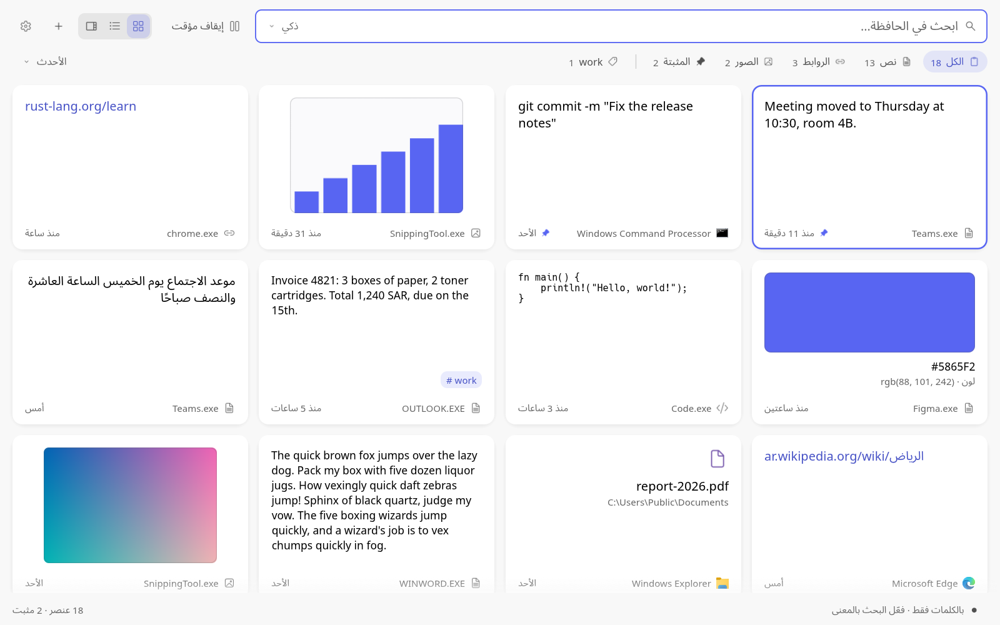

# مدير الحافظة (clipboard-manager)

[English](README.md) · **العربية**

**كل ما تنسخه، تجده من جديد بمعناه. دون اتصال، على ويندوز.**

- **ابحث بالمعنى.** اكتب «إيصال محل الأدوات» فتجد الصورة التي نسختها الأسبوع الماضي، بنموذج تضمين على خادمك
  (llama.cpp أو Ollama أو LM Studio أو vLLM أو Unsloth أو OpenRouter).
- **يقرأ النص في الصور.** تظهر لقطات الشاشة والصور في البحث بكلماتها، يقرؤها ويندوز أو نموذج رؤية على خادمك.
- **يبقى على جهازك.** سجلك مشفّر بحساب ويندوز، وتُستبعد كلمات المرور والمفاتيح التي تنسخها، ولا يخرج شيء من
  جهازك إلا إلى خادم تختاره.

## المزايا

- **سجل الحافظة:** النصوص والروابط والصور والملفات المنسوخة. تُدمج النسخ المكررة، ويمكنك تثبيت العناصر لتبقى دائمًا.
- **البحث بالكلمات أو بالمعنى:** الوضع «ذكي» يرتّب النتائج حسب قرب المعنى مع أفضلية للعناصر التي تحتوي كلماتك، وتتطابق أشرطة الصلة مع الترتيب.
- **قراءة النص في الصور:** بقارئ Windows أو بنموذج رؤية على خادمك، فتجد لقطات الشاشة بالكلمات التي فيها.
- **خوادمك ونماذجها:** احفظ الخوادم التي تعمل عليها نماذجك، بنوعها وعنوانها ومنفذها ومفتاحها، ولكل خادم عدة نماذج بإعداداتها. اختر النموذج المستخدم من قائمة واحدة، واختبره، واملأ تفاصيله من models.dev. ويمكن للتطبيق تشغيل llama-server نيابةً عنك لنموذج البحث ولنموذج القراءة، من ملف النموذج أو من اسمه على Hugging Face.
- **الوسوم والتثبيت:** أضف وسمًا بـ `Ctrl+T`، وصفِّ العناصر حسب الوسم، والعناصر الموسومة والمثبتة لا تُحذف تلقائيًا.
- **تحديد عدة عناصر:** يضيف `Ctrl` مع النقر عنصرًا أو يزيله، ويحدد `Shift` مع النقر عناصر متتالية، ويوسّع `Shift` مع السهمين التحديد، ويحدد `Ctrl+A` كل ما يظهر. بعدها تثبّتها أو تضيف إليها وسمًا أو تنسخها معًا أو تحذفها دفعة واحدة، و«تراجع» واحد يعيد كل ما حُذف.
- **لوحة المفاتيح:** يلصق `Ctrl+1` إلى `Ctrl+9` أحد العناصر التسعة الأولى، ويفتح النقر بالزر الأيمن أو `Shift+F10` قائمة العنصر بكل إجراءاته ومفاتيحها، ويعرض `F1` كل المفاتيح.
- **طرق عرض:** شبكة (بطاقات) أو قائمة أو تفاصيل، مع أزرار عند المرور على العنصر: حذف، تثبيت، نسخ، فتح التفاصيل.
- **الترتيب:** الأقرب تطابقًا (أثناء البحث)، الأحدث، الأقدم، أبجديًا، الأكثر استخدامًا.
- **العربية والإنجليزية:** الواجهة كلها من اليمين إلى اليسار بالعربية، والنص العربي يظهر متصل الحروف وبالترتيب الصحيح حتى مع الأرقام والكلمات الإنجليزية.
- **ساعة 12 أو 24:** تُحفظ الأوقات بالتوقيت العالمي وتُعرض بتوقيتك المحلي.
- **علبة النظام والتشغيل عند تسجيل الدخول:** من «الإعدادات ← عام».
- **اختصارات قابلة للتعديل:** انقر الاختصار ثم اضغط المفاتيح الجديدة.
- **إعدادات تشرح نفسها:** سبع صفحات: عام، والمظهر، والحافظة، والخصوصية، والبحث والذكاء الاصطناعي، والاختصارات واللصق، وحول التطبيق. تحت كل إعداد سطر قصير يقول ما يفعله، وتعرض صفحة الخصوصية أين تذهب كل بياناتك.
- **البداية وما الجديد:** في التثبيت الجديد تظهر قائمة قصيرة «ابدأ من هنا» تُعلَّم خطواتها وحدها، وبعد كل تحديث تخبرك أول نافذة بما الجديد.

## التثبيت

نزّل الملف **clipboard-manager-windows-x64.exe** من [صفحة الإصدارات](https://github.com/NourEldin-Osama/clipboard-manager/releases/latest) وشغّله. لا يحتاج إلى مثبّت. ضعه في مجلد يمكنك الكتابة فيه، مثل `%LOCALAPPDATA%\Programs\clipboard-manager\`، كي يتمكن من تحديث نفسه.

## التحديثات

يتحقق التطبيق من وجود إصدار جديد عند بدء التشغيل ومرة يوميًا، فيجلب ملف الإصدار من GitHub فقط دون إرسال أي شيء عنك. عند وجود إصدار أحدث ينزّله في الخلفية ثم يعرض «أعد التشغيل للتحديث»، وإن لم تُعد التشغيل فسيُثبَّت عند الخروج. لا يُثبَّت أي تنزيل إلا إذا طابق بصمة SHA-256 وتوقيع Ed25519 الصادر عن سير عمل الإصدار. يمكنك إيقاف التحقق أو جعله يسألك قبل التنزيل من «الإعدادات ← حول التطبيق ← التحديثات».

## الخصوصية

لا يُرسل أي شيء تنسخه إلى أي مكان، إلا إن اخترت خادمًا ليس على هذا الجهاز، وعندها يحذّرك التطبيق ويسألك أولًا. الاتصال بالشبكة يقتصر على الخوادم التي تضيفها، وموقع models.dev حين تنقر «املأ التفاصيل»، والتحقق من التحديثات الذي يمكن إيقافه. تُحفظ البيانات على جهازك في `%APPDATA%\clipboard-manager\data`.

## البناء من المصدر والمساهمة

تفاصيل البناء والنماذج والبنية في [README بالإنجليزية](README.md)، وطريقة المساهمة في [CONTRIBUTING.md](CONTRIBUTING.md).

## الترخيص

مرخّص بموجب MIT أو Apache-2.0، حسب اختيارك. خطا Noto Sans وNoto Sans Arabic مرخّصان بموجب SIL Open Font License، والأيقونات من Fluent UI System Icons (MIT) وMaterial Symbols (Apache 2.0)، وتراخيص شعارات الخوادم في `assets/logos`.

